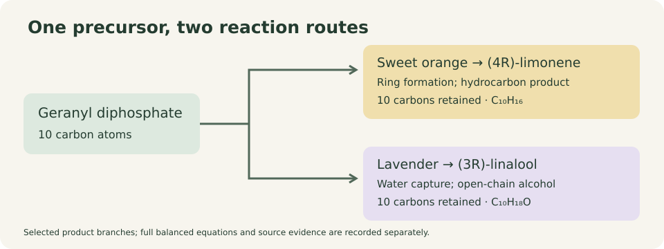
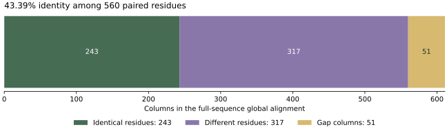

# Nature's Perfume Lab: reproducible case study

Two documented plant enzymes use the same ten-carbon precursor but produce different molecular shapes. This report combines source-backed reactions, a descriptive sequence alignment, and checks of one experimental protein structure. It does not predict smell or new enzyme activities.

## The chemical result

| Molecule | Formula in the selected representation | Carbon atoms | Rings |
| --- | --- | ---: | ---: |
| (2E)-Geranyl diphosphate | C10H20O7P2 | 10 | 0 |
| (4R)-(+)-Limonene | C10H16 | 10 | 1 |
| (3R)-(−)-Linalool | C10H18O | 10 | 0 |

All ten carbon labels occur once in each displayed molecule. Limonene has a ring; linalool remains acyclic and contains an alcohol group. The neutral-species reaction equations balance all elements and formal charge. Neutral bookkeeping does not specify physiological proton stoichiometry.



**Figure 1. The selected product branches.** The diagrams summarize documented reactions and the curated atom map. They do not show every intermediate or side product. Carbon labels describe a representative lineage map, not a simulated isotope experiment. Small-molecule 3D coordinates in the explorer are calculated display conformers, not experimental or protein-bound structures.

## The sequence comparison

Citrus sinensis A0A1C9J6A7 has 607 residues; Lavandula angustifolia Q2XSC5 has 564. The global alignment has **611 columns**, including **560 paired-residue columns** and **51 gap columns**. Of the paired residues, **243 are identical** and **317 differ**.

Identity is **43.39%** when divided by paired-residue columns, or **39.77%** when divided by all alignment columns. The score is **86.5**, using match +2, mismatch −1, gap opening −10, and extension −0.5, including terminal gaps. The first optimum returned by the pinned alignment library is saved; other optimal placements may exist.



**Figure 2. Sequence identity is descriptive.** Both inputs are full canonical sequences. Their different species, N-terminal regions, and assay preparations limit a functional interpretation. These two examples cannot identify a causal product-switching residue or validate a classifier.

Inspect [the aligned sequences](alignment.fasta), [the per-column residue table](residue_alignment.csv), and [the complete analysis](analysis.json).

## Experimental structure evidence

PDB **5UV0 chain A** contains **522 unique modeled alpha-carbon positions** in the 607-residue reference mapping, with **0 current coordinate/sequence mismatches**. The reference sequence is distinct from the tagged, truncated expression construct. Historical database-conflict annotations are retained in the source record rather than interpreted as present sequence differences.

No experimental structure for the selected lavender enzyme is included. The analysis therefore makes no cross-enzyme structural alignment, pocket-volume comparison, or inferred ligand pose.

## Evidence and limits

The citrus primary study reports a predominantly limonene product profile with minor products; a route card is not a claim of absolute product purity. The lavender source supports R-linalool formation. Their assays are not a matched experiment. Whole-plant aromas depend on mixtures, concentration, and perception; the same compound name does not specify every stereoisomer or odor experience.

The 2026 monoterpene-classification paper motivates the topic but its machine-learning analysis is not reproduced here. Passing the source, structural, atom-map, balance, and replay checks establishes the stated computational consistency, not a new biochemical discovery.

## Reproduce and inspect

From the repository root:

```sh
python run.py --output-dir .reproduction
python verify_results.py --results-dir .reproduction
```

The independent verifier checks source and artifact fingerprints, sequence recovery, alignment counts and optimal score, curated chemical identities and maps, and selected structural records. Hash checks on figures and prose do not establish their scientific interpretation. See the repository documentation for exact verification coverage and source access.

Source inventory SHA-256: `9cb85f361767e03e2c3580d26d3699cfe6f6068f3ca82f13e17c3522f7e4b561`.
